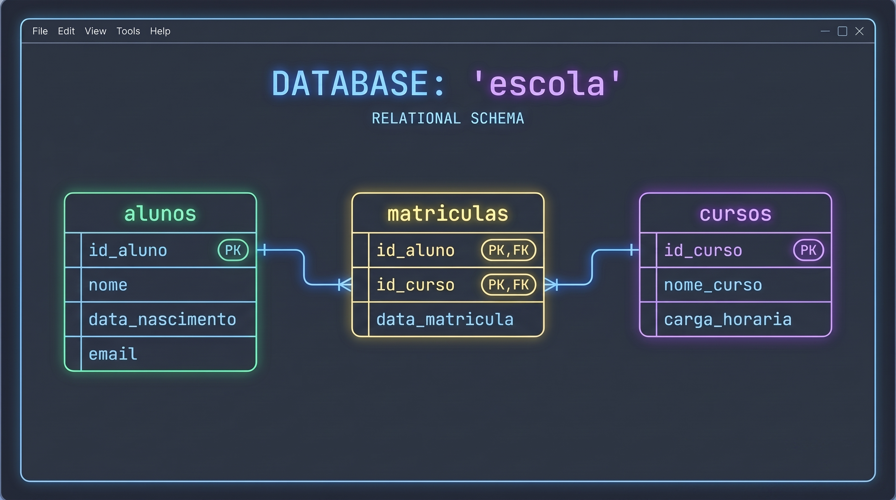

> **Curso:** Engenharia de Software / Tecnologia em Análise e Desenvolvimento de Sistemas  
> **Disciplina:** Linguagem e Técnicas de Programação    
> **Tema:**  Bancos de Dados Conceitos Iniciais    
> **Professor:** José Carlos Flores  
> **Objetivo:** Laboratório Prático SQL
---

# 🧪 Laboratório prático SQL: Banco de Dados `escola`

**Objetivo**: Criar o banco de dados `escola`, implementar tabelas com Chaves Primárias (**PK**), Chaves Estrangeiras (**FK**), executar inserções, consultas relacionais com `JOIN`, atualizações e remoções de dados.  



<!--    -->


---

### **Passo 1: Configuração do ambiente no XAMPP**

1. Abra o **XAMPP Control Panel** e inicie os serviços **Apache** e **MySQL** clicando em **Start**.
2. No seu navegador, acesse o endereço: `http://localhost/phpmyadmin/`.
3. No menu superior, clique na aba **SQL** (ou no menu lateral em **Novo**) e execute os comandos para criar e selecionar o banco de dados:

```sql
CREATE DATABASE escola;
USE escola;
```

---

### **Passo 2: Criação das tabelas (DDL - Data Definition Language)**
*(Estrutura exata definida no slide 16)*

> **Nota**: Criamos primeiro as tabelas independentes (`alunos` e `cursos`) e por último a tabela associativa (`matriculas`), pois ela depende das chaves estrangeiras das duas primeiras.

1. **Criar a Tabela `alunos`**:
   * Contém `id_aluno` como **Primary Key** com auto incremento, campo `nome` obrigatório (`NOT NULL`) e `email` único (`UNIQUE`).

```sql
CREATE TABLE alunos ( 
  id_aluno INT AUTO_INCREMENT PRIMARY KEY, 
  nome VARCHAR(100) NOT NULL, 
  data_nascimento DATE, 
  email VARCHAR(100) UNIQUE 
);
```

2. **Criar a Tabela `cursos`**:
   * Contém `id_curso` como **Primary Key** e campo `nome_curso` obrigatório.

```sql
CREATE TABLE cursos ( 
  id_curso INT AUTO_INCREMENT PRIMARY KEY, 
  nome_curso VARCHAR(100) NOT NULL, 
  carga_horaria INT 
);
```

3. **Criar a Tabela `matriculas` (Relacionamento N:M)**:
   * Possui uma **Chave Primária Composta** (`PRIMARY KEY (id_aluno, id_curso)`) e duas **Chaves Estrangeiras** (`FOREIGN KEY`) que garantem a integridade referencial com as tabelas `alunos` e `cursos`.

```sql
CREATE TABLE matriculas ( 
  id_aluno INT, 
  id_curso INT, 
  data_matricula DATE, 
  PRIMARY KEY (id_aluno, id_curso), 
  FOREIGN KEY (id_aluno) REFERENCES alunos(id_aluno), 
  FOREIGN KEY (id_curso) REFERENCES cursos(id_curso) 
);
```

---

### **Passo 3: Inserção de registros (DML - INSERT)**

Copie e execute os comandos abaixo para popular as tabelas com dados de teste:

```sql
-- 1. Inserir Alunos
INSERT INTO alunos (nome, data_nascimento, email) VALUES
('Ana Silva', '2002-05-15', 'ana.silva@email.com'),
('Bruno Costa', '2000-11-20', 'bruno.costa@email.com'),
('Carla Souza', '2003-01-10', 'carla.souza@email.com');

-- 2. Inserir Cursos
INSERT INTO cursos (nome_curso, carga_horaria) VALUES
('Banco de Dados SQL', 60),
('Programação PHP', 80),
('Desenvolvimento Web', 40);

-- 3. Inserir Matrículas (associando alunos aos cursos)
INSERT INTO matriculas (id_aluno, id_curso, data_matricula) VALUES
(1, 1, '2026-02-01'), -- Ana matriculada em Banco de Dados SQL
(1, 2, '2026-02-02'), -- Ana matriculada em Programação PHP
(2, 1, '2026-02-01'), -- Bruno matriculado em Banco de Dados SQL
(3, 3, '2026-02-05'); -- Carla matriculada em Desenvolvimento Web
```

---

### **Passo 4: Consultas aos dados (DML - SELECT)**

1. **Consulta simples** para visualizar todos os alunos cadastrados:
```sql
SELECT * FROM alunos;
```

2. **Consulta com `INNER JOIN`** integrando as três tabelas para listar o nome do aluno, o curso em que está matriculado e a data da matrícula:
```sql
SELECT 
    a.nome AS Aluno,
    c.nome_curso AS Curso,
    m.data_matricula AS Data_Matricula
FROM matriculas m
INNER JOIN alunos a ON m.id_aluno = a.id_aluno
INNER JOIN cursos c ON m.id_curso = c.id_curso;
```

---

### **Passo 5: Atualização de registros (DML - UPDATE)**

1. **Atualizar o e-mail** do aluno Bruno Costa (`id_aluno = 2`):
```sql
UPDATE alunos 
SET email = 'bruno.novo.email@email.com' 
WHERE id_aluno = 2;
```

2. **Atualizar a carga horária** do curso de "Banco de Dados SQL" (`id_curso = 1`) para 70 horas:
```sql
UPDATE cursos 
SET carga_horaria = 70 
WHERE id_curso = 1;
```

---

### **Passo 6: Exclusão de registros (DML - DELETE)**

1. **Remover uma matrícula específica** (cancelar a matrícula da aluna Ana no curso de PHP - `id_aluno = 1` e `id_curso = 2`):
```sql
DELETE FROM matriculas 
WHERE id_aluno = 1 AND id_curso = 2;
```

2. **Testando a Integridade Referencial (FK)**:
   * *Atenção*: Se tentar executar `DELETE FROM alunos WHERE id_aluno = 3;` diretamente, o MySQL retornará um **erro de restrição de Chave Estrangeira**, pois a aluna Carla tem registro na tabela `matriculas`.
   * Para remover o registro com sucesso, exclua primeiro o vínculo na tabela filha (`matriculas`) e depois o registro principal (`alunos`):

```sql
-- 1º: Exclui a matrícula relacionada
DELETE FROM matriculas WHERE id_aluno = 3;

-- 2º: Exclui a aluna
DELETE FROM alunos WHERE id_aluno = 3;
```

---

## 📜 Script SQL completo para importação

Abaixo encontra-se o código SQL completo e consolidado para ser salvo como `escola_laboratorio.sql` e importado diretamente via aba **Importar** do phpMyAdmin.

```sql
-- ============================================================
-- SCRIPT DE LABORATÓRIO SQL - BANCO DE DADOS ESCOLA
-- Compatível com MySQL / MariaDB (XAMPP - phpMyAdmin)
-- Baseado no Slide 16 do Guia CREATE TABLE
-- ============================================================

-- 1. Criar e selecionar o Banco de Dados
CREATE DATABASE IF NOT EXISTS escola;
USE escola;

-- 2. Limpar tabelas caso já existam (ordem respeitando as Chaves Estrangeiras)
DROP TABLE IF EXISTS matriculas;
DROP TABLE IF EXISTS cursos;
DROP TABLE IF EXISTS alunos;

-- 3. Criar Tabela: alunos
CREATE TABLE alunos (
  id_aluno INT AUTO_INCREMENT PRIMARY KEY,
  nome VARCHAR(100) NOT NULL,
  data_nascimento DATE,
  email VARCHAR(100) UNIQUE
) ENGINE=InnoDB DEFAULT CHARSET=utf8mb4;

-- 4. Criar Tabela: cursos
CREATE TABLE cursos (
  id_curso INT AUTO_INCREMENT PRIMARY KEY,
  nome_curso VARCHAR(100) NOT NULL,
  carga_horaria INT
) ENGINE=InnoDB DEFAULT CHARSET=utf8mb4;

-- 5. Criar Tabela: matriculas (Tabela Associativa N:M)
CREATE TABLE matriculas (
  id_aluno INT,
  id_curso INT,
  data_matricula DATE,
  PRIMARY KEY (id_aluno, id_curso),
  FOREIGN KEY (id_aluno) REFERENCES alunos(id_aluno) ON DELETE RESTRICT ON UPDATE CASCADE,
  FOREIGN KEY (id_curso) REFERENCES cursos(id_curso) ON DELETE RESTRICT ON UPDATE CASCADE
) ENGINE=InnoDB DEFAULT CHARSET=utf8mb4;

-- ============================================================
-- INSERÇÃO DE DADOS DE TESTE (DML - INSERT)
-- ============================================================

-- Inserir Alunos
INSERT INTO alunos (nome, data_nascimento, email) VALUES
('Ana Silva', '2002-05-15', 'ana.silva@email.com'),
('Bruno Costa', '2000-11-20', 'bruno.costa@email.com'),
('Carla Souza', '2003-01-10', 'carla.souza@email.com');

-- Inserir Cursos
INSERT INTO cursos (nome_curso, carga_horaria) VALUES
('Banco de Dados SQL', 60),
('Programação PHP', 80),
('Desenvolvimento Web', 40);

-- Inserir Matrículas
INSERT INTO matriculas (id_aluno, id_curso, data_matricula) VALUES
(1, 1, '2026-02-01'), -- Ana matriculada em Banco de Dados SQL
(1, 2, '2026-02-02'), -- Ana matriculada em Programação PHP
(2, 1, '2026-02-01'), -- Bruno matriculado em Banco de Dados SQL
(3, 3, '2026-02-05'); -- Carla matriculada em Desenvolvimento Web

-- ============================================================
-- CONSULTAS DE VERIFICAÇÃO (DML - SELECT)
-- ============================================================

-- Listar todas as matrículas com os nomes dos alunos e cursos
SELECT 
    a.nome AS Aluno,
    c.nome_curso AS Curso,
    m.data_matricula AS Data_Matricula
FROM matriculas m
INNER JOIN alunos a ON m.id_aluno = a.id_aluno
INNER JOIN cursos c ON m.id_curso = c.id_curso;
```

---

## 👤 GitHub

[](https://github.com/floresjcd) 
**[@floresjcd](https://github.com/floresjcd)**
